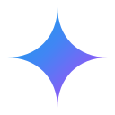
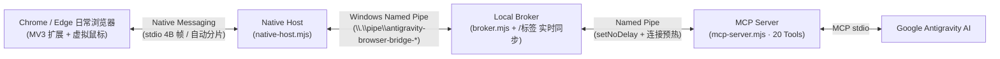

# Antigravity Browser Bridge

<p align="center">
  
</p>

**Browser Bridge** 是一套专为 **Google Antigravity** 打造的**日常主浏览器直连插件 + Chrome / Edge Manifest V3 浏览器扩展**。

它通过浏览器原生的 **Native Messaging** 与本地 **Windows Named Pipe** 将你日常正在使用的 Chrome / Edge 直接连接到 Antigravity AI——**100% 保留你原有的登录态、Cookie 与已打开标签页**，无需另开空白的无头浏览器，也不在本地暴露任何 TCP 调试端口。

---

## ✨ 核心特性

- **🔗 日常浏览器直连（零 TCP 端口暴露）**
  - 采用 `Chrome/Edge Extension (MV3)` ↔ `Native Messaging Host` ↔ `Windows Named Pipe Broker` ↔ `MCP Server` 架构，支持 Chrome 与 Edge 同时在线并存，内置共享密钥（`.bridge-token`）双向鉴权与 >700 KB 大报文自动分片重组。
- **⚡ `/` 斜杠菜单实时同步已打开标签页**
  - 自动将当前浏览器打开的网页同步到 Antigravity 的 `/` 斜杠技能菜单（如 `/标签-主页-X`、`/标签-哔哩哔哩-...`），输入 `/` 即可直接点选目标网页下达指令；支持在扩展弹窗切换 **「自动同步 (最多10页)」**、**「仅同步选定页」** 或 **「关闭同步」**。
- **🖱️ 拟真丝滑虚拟鼠标（常驻待命 + 极速零阻塞点击）**
  - 内置三阶贝塞尔弧线飞行轨迹、切线方向角动态倾转、速度拉伸形变、点击脉冲波纹、屏幕四周蓝紫呼吸光晕以及标签页 Favicon 动态徽章。
  - **常驻待命与跨页坐标继承**：首次观察页面（`get_page_snapshot`）即异步预挂载调试器并唤出待命鼠标（`Gemini · 待命中`），后续点击 **0ms 瞬发**；支持跨整页跳转、刷新及新开标签页自动继承上一次点击坐标，原地无缝起飞。
- **🔍 全景 DOM 穿透（Shadow DOM + 同源 / 跨域 `iframe`）**
  - 结合 `chrome.dom.openOrClosedShadowRoot` 与 `allFrames: true` 跨帧坐标自动拼接（`f<frameId>_e<N>`），无论是挂载在 ShadowRoot 里的自定义扩展界面（如 Bilibili BewlyBewly），还是嵌套在跨域子域名 `iframe` 中的系统（如超星学习通作业页），均能一步精准提取与点击。
- **🚀 `run_steps` 批量流水线执行**
  - 支持将「滚动页面 → 点击链接 → 自动切换到新开标签页 → 等待弹窗 → 输入文本 → 点赞并附带返回最新页面快照」合并为 **1 次** `run_steps` 工具调用在浏览器端连续完成，大幅减少大模型多轮往返耗时。

---

## 🏗️ 架构示意



---

## 📦 目录结构

```text
browser-bridge/
├── assets/
│   └── logo.svg                         # Gemini 四芒星插件图标
├── extension/                           # Chrome / Edge Manifest V3 浏览器扩展源码
│   ├── icons/                           # 16 / 32 / 48 / 128px 扩展图标
│   ├── manifest.json                    # 固定公钥与确定性扩展 ID (mnccmppmfbpfjimoacoamffodlepbjhl)
│   ├── background.js                    # 核心调度、全景 DOM/iframe 穿透、Gemini 虚拟鼠标与 CDP 交互
│   ├── popup.html / popup.css / popup.js# 扩展控制弹窗（连接状态、虚拟鼠标开关、/菜单同步模式、标签页选定）
├── browser-bridge-extension.zip         # 打包好的浏览器扩展压缩包（解压即可在 chrome://extensions 加载）
├── native-host/
│   ├── com.antigravity.browser_bridge.json # Native Messaging Host 清单
│   ├── native-host.cmd                  # 自动探测 Node.js 的启动入口
│   ├── native-host.mjs                  # Native Messaging <-> Named Pipe 桥接进程
│   ├── register.ps1                     # 一键配置绝对路径并写入 Chrome / Edge 注册表脚本
│   └── unregister.ps1                   # 注册表卸载脚本
├── server/
│   ├── protocol.mjs                     # 帧协议、分片重组、Token 鉴权与进程拉起工具
│   ├── broker.mjs                       # 多浏览器连接中心与 /标签-* 动态技能同步器
│   └── mcp-server.mjs                   # 零依赖 Node.js MCP Server（提供 20 个工具与动态资源）
├── skills/
│   └── browser-bridge/SKILL.md          # 核心技能说明（动态标签页技能会实时生成在 skills/_tab-* 下）
├── rules/
│   └── AGENTS.md                        # Antigravity Agent 默认行为规则
├── mcp_config.json                      # Antigravity 插件 MCP 配置文件
└── plugin.json                          # Antigravity 插件清单
```

---

## 🚀 安装与配置指南

### 前置要求
- **操作系统**：Windows 10 / 11
- **Node.js**：建议使用 Node.js v18+（推荐 v20 / v22 / v24，零第三方 npm 依赖，无需 `npm install`）
- **浏览器**：Google Chrome 或 Microsoft Edge

### 第一步：安装 Antigravity 插件
将本仓库克隆或放置到 Antigravity 的全局插件目录：

```powershell
git clone https://github.com/Candy-QAQ/antigravity-browser-bridge.git "$env:USERPROFILE\.gemini\config\plugins\browser-bridge"
```

### 第二步：一键注册 Native Messaging Host 与 MCP 路径
在 PowerShell 中运行 `native-host\register.ps1`（脚本会自动探测本机 `node.exe` 位置，自动生成当前用户路径对应的 `mcp_config.json` 与 `com.antigravity.browser_bridge.json`，并写入当前用户的 Chrome / Edge 注册表，无需管理员权限）：

```powershell
powershell -ExecutionPolicy Bypass -File "$env:USERPROFILE\.gemini\config\plugins\browser-bridge\native-host\register.ps1"
```

> 如需卸载注册表项，可随时运行同目录下的 `unregister.ps1`。

### 第三步：在 Chrome / Edge 中加载浏览器扩展
你可以直接使用仓库内的 `extension/` 文件夹，或将打包好的 **`browser-bridge-extension.zip`** 解压到任意固定目录：

1. 在浏览器地址栏打开扩展管理页：
   - Chrome：`chrome://extensions`
   - Edge：`edge://extensions`
2. 开启右上角的 **「开发者模式」 (Developer mode)**。
3. 点击左上角 **「加载已解压的扩展程序」 (Load unpacked)**，选择本仓库下的 `extension` 目录（或 `browser-bridge-extension.zip` 解压后的文件夹）。
4. 加载完成后，扩展 ID 会自动固定为 `mnccmppmfbpfjimoacoamffodlepbjhl`。点击浏览器右上角工具栏中的 **Gemini 四芒星图标**，看到绿灯 **「已连接到 Antigravity Native Host」** 即表示连接成功！

---

## 🛠️ MCP 工具一览（共 20 个）

| 分类 | 工具名称 | 功能说明 |
| :--- | :--- | :--- |
| **状态与标签页发现** | `bridge_status` | 查看 Broker 运行状态、已连接浏览器（Chrome/Edge）、选定标签页及调试器附着状态 |
| | `list_tabs` | 列出所有已连接浏览器的全部标签页（支持按浏览器、关键词、激活状态、选定状态过滤） |
| | `get_active_tab` | 获取用户在扩展弹窗中「选定」的目标页及各浏览器的当前活动标签页 |
| **内容提取与快照** | `read_page_content` | **纯只读无横幅**提取标题、大纲、正文与链接（自动穿透 Shadow DOM 与同源/跨域 `iframe`） |
| | `get_page_snapshot` | 提取可见可交互元素并分配 `e1`, `e2` / `f<frameId>_e<N>` 引用编号与坐标，同时异步预热调试器与待命鼠标 |
| **标签页生命周期** | `switch_tab` | 切换并聚焦到指定 `tabId` 所在窗口和标签页 |
| | `open_tab` | 新建标签页并打开指定 URL |
| | `close_tab` | 关闭指定 `tabId` 标签页 |
| | `navigate_tab` | 控制标签页跳转 URL、后退 (`back`)、前进 (`forward`) 或刷新 (`reload`)，支持附带返回快照 |
| **页面交互与批处理** | `click_element` | 支持 `ref`、`selector`、`text` 或 `(x, y)` 坐标点击/双击/右键，带贝塞尔虚拟鼠标动画与新开标签页检测 |
| | `fill_element` | 向输入框、`textarea`、`contenteditable` 或 `<select>` 填入内容，兼容 React / Vue 受控组件 |
| | `press_key` | 发送键盘按键或组合键（如 `Enter`、`Escape`、`Control+a`） |
| | `scroll_page` | 上下滚动页面、直达顶部/底部，或将指定元素滚动到视口中央 |
| | `wait_for` | 轮询等待指定 `selector` 或 `text` 出现在页面中（支持穿透 `iframe` 与 Shadow DOM） |
| | **`run_steps`** | **高速批处理核心**：单次调用连续执行 `click` / `fill` / `scroll` / `wait_for` / `press_key` / `navigate` / `snapshot`，支持自动追随新开标签页 (`switchToNewTab: true`) 与一步返回最终快照 (`includeSnapshot: true`) |
| **截图与深度调试** | `take_screenshot` | 对前台可见区域优先使用无横幅极速截图；整页 (`fullPage: true`) 或后台标签页自动切换 CDP 截图 |
| | `evaluate_script` | 在页面上下文中执行任意 JavaScript 表达式并获取返回值 |
| | `get_console_logs` | 捕获并读取页面的 `console.log / warn / error` 及未捕获异常 |
| | `get_network_requests` | 捕获并读取页面的网络请求列表（URL、方法、状态码、资源类型、失败原因） |
| | `detach_debugger` | 手动分离调试器并收起虚拟鼠标（默认保持常驻待命以获得零延迟体验） |

---

## 💡 使用技巧

1. **`/` 菜单直选网页**：在 Antigravity 输入框敲 `/标签-` 即可直接选中当前正在浏览的网页（例如 `/标签-主页-X 往下划一下找个帖子点赞`）。
2. **弹窗固定目标页**：如果打开了很多标签页，点击浏览器右上角扩展图标，在列表中点 **「选定」** 即可将该页置顶锁定为 AI 的默认操作对象。
3. **常驻待命与随时断开**：执行点击后虚拟鼠标会停留在原地（`Gemini · 待命中`）以便下一条指令瞬发响应；如果你想隐藏鼠标或关闭浏览器顶部的调试提示条，只需打开扩展弹窗点击 **「分离调试器」** 或关闭 **「显示虚拟鼠标」** 开关即可。
